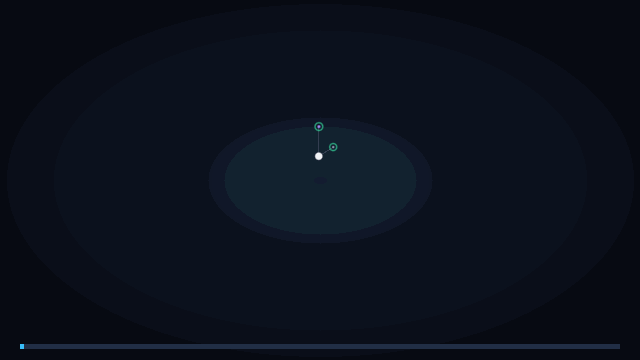

# GitStory

**Paste a repo, press play, watch how a project was built.**

GitStory turns any Git repository into an animated, watchable documentary—replaying files appearing, changing, renaming, and fading away, highlighting milestones and releases as chapters, tracking contributors, comparing module architecture between refs, and exporting MP4 or GIF clips. Local-first, private, zero accounts.



---

## Features

- **Local-First & Private:** Local repositories are analyzed on your machine using real `git` and never uploaded anywhere.
- **Animated File-Tree Replay (PixiJS WebGL + Canvas2D fallback):** Layout-stable radial tree (`FR-16`, `FR-22`) where files bloom on creation, flash on edit, glide smoothly across renames (`-M -C`), and fade out on deletion.
- **Documentary Pacing & Highlights:** Custom virtual-clock timeline (`@gitstory/timeline`) compresses quiet periods, slows down on automatically detected highlights (release tags, new top-level directories, landmark commits, contributor surges, mass refactors), and supports constant-speed mode, chapter jumps, and keyboard shortcuts.
- **Multiple Perspectives:**
  - **Replay View:** Stable animated file tree with pan/zoom and tooltips.
  - **Treemap View:** Animated squarified treemap showing codebase size over time.
  - **Contributor View:** Active contributor avatars gravitating toward files they touch + interactive activity streamgraph with bot dimming/hiding.
  - **Architecture Diff (v2):** Compare TypeScript/JavaScript/Python module dependency graphs between any two tags or commits in Diff Overlay or Side-by-Side mode (`gitstory arch`).
- **Large-Repo Scaling:** Automatic daily/weekly aggregation, deep directory collapsing, configurable node cap, Web Worker offloading, and IndexedDB caching (`idb`).
- **Video & GIF Export:** Deterministic MP4 (WebCodecs + `mp4-muxer`) and universal GIF89a (`gifenc`) export with live progress and cancellation.
- **Accessibility:** Keyboard-operable controls (`Space`, `←`/`→`, `[`/`]`, `Home`), reduced-motion mode, and Okabe–Ito colorblind-safe palette.

---

## 5-Minute Quickstart

### Prerequisites
- **Node.js** `>= 20`
- **pnpm** `>= 8`
- **Git** installed on `PATH`

### 1. Install & Build
```bash
git clone https://github.com/hatimbenayad/GitStory.git
cd GitStory
pnpm install
pnpm build
```

### 2. Visualize Any Local Repository via CLI
```bash
# Option A: Extract history.json and immediately launch the local web player
node apps/cli/dist/cli.js /path/to/your-repo --serve

# Option B: Generate a portable history.json file (then drop it in the web app)
node apps/cli/dist/cli.js /path/to/your-repo -o history.json

# Option C: Compare module architecture between two tags or commits
node apps/cli/dist/cli.js /path/to/your-repo arch v0.1.0 v1.0.0 -o arch-diff.json
```

### 3. Run the Web App in Dev Mode
```bash
pnpm dev
```
Open `http://localhost:5173`, drop any `history.json`, open a local repo folder (Chromium File System Access API), or click **Watch Sample Story**.

### 4. Optional Backend for Public GitHub URLs
GitStory works 100% offline without a backend. To enable pasting public `https://github.com/owner/repo` URLs:
```bash
pnpm --filter @gitstory/server start
```
Then enter `http://localhost:8787` in the **Public GitHub URL** panel (or set `VITE_API_BASE_URL=http://localhost:8787`).

---

## Monorepo Architecture

```text
GitStory/
├─ PRD.md                   # Source-of-truth Product Requirements Document
├─ docs/                    # Constitution, Intent, User Stories, Units, ADRs, Progress, Runbook, Demo
├─ specs/                   # SDD specs (spec.md, plan.md, tasks.md) for Units U1–U15
├─ packages/
│  ├─ core/                 # Schema v1 types/validator, ReplayEngine + keyframes, highlights, large-repo, narration
│  ├─ extractor/            # Single-pass streaming git log parser, .mailmap, bot detection, ref snapshot reader
│  ├─ layout/               # Stable radial tree, squarified treemap, contributor streamgraph, architecture diff graph
│  ├─ timeline/             # Virtual clock, adaptive documentary pacing, scrubbing, chapter jumps
│  └─ exporter/             # WebCodecs + mp4-muxer MP4 & pure-TS GIF89a exporter
├─ apps/
│  ├─ web/                  # React + Vite + Zustand + PixiJS WebGL web app (IndexedDB + Web Worker)
│  ├─ cli/                  # `gitstory` CLI (`extract`, `serve`, `arch`)
│  └─ server/               # Optional Node + Hono read-only blobless GitHub clone/cache service
└─ scripts/                 # Synthetic 5k/10k benchmark & self-history demo generator
```

---

## Scripts

| Command | Description |
|---|---|
| `pnpm build` | Build all packages and apps in dependency order |
| `pnpm dev` | Start Vite dev server for `apps/web` |
| `pnpm lint` | Run ESLint across the entire workspace |
| `pnpm typecheck` | Run strict `tsc --noEmit` across all workspaces |
| `pnpm test` | Run all Vitest unit and fixture-repo integration tests |
| `pnpm test:e2e` | Run Playwright E2E smoke suite against built web app |
| `pnpm bench` | Run 5,000- and 10,000-commit synthetic performance benchmarks |

---

## Deployment

- **GitHub Pages (Primary — see ADR-004):** `.github/workflows/deploy.yml` builds `apps/web` on pushes to `main` and deploys `apps/web/dist` automatically when GitHub Pages is set to "GitHub Actions".
- **Vercel:** `vercel.json` is included for zero-config static deployments.

---

## Documentation

- [Project Constitution](docs/constitution.md)
- [Intent & Success Criteria](docs/intent.md)
- [User Stories](docs/user-stories.md)
- [Unit Decomposition](docs/units.md)
- [Architecture Decision Records (ADRs)](docs/decisions/)
- [Operations Runbook](docs/runbook.md)
- [Contributing Guide](CONTRIBUTING.md)
